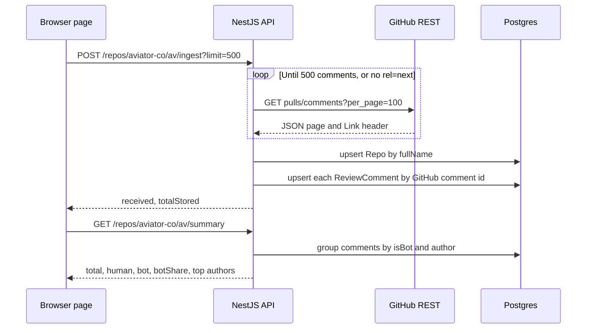

# Slop Registry, explained

This is the walkthrough for Day 1. Read it once out loud. If a sentence is fuzzy, the code it points at is the thing to open, not a slide.

The product takes a public GitHub repo and turns recurring human review comments into draft rules ("invariants") with links back to the comments. Day 1 is the part you can check without a model: fetch the comments, store them, and count humans against bots. Day 2, in the last section of this file, classifies the comments, embeds them, clusters the recurring ones, and drafts invariants.

The numbers for `aviator-co/av` are in [day1-results.md](day1-results.md). Use those. Do not round them from memory.

## What each folder does

```text
apps/web                         the page
  src/app/page.tsx               the form and the summary. Client component, because it holds the input and the result in state.
  src/app/layout.tsx             title, fonts, the HTML shell
  .env.development               NEXT_PUBLIC_API_URL

apps/api                         the HTTP API
  src/main.ts                    starts Nest, loads the root .env, turns on CORS, listens on PORT
  src/load-env.ts                finds the repo-root .env from the compiled file's location
  src/app.module.ts              wires PrismaModule and ReposModule
  src/prisma/                    one PrismaClient, connected on startup
  src/github/                    talking to GitHub, and the pure functions that interpret the payload
  src/repos/                     the routes: ingest, classify, cluster, invariants, summary, exports
  src/classify/                  the label schema, the prompt, the cache, the OpenAI call
  src/cluster/                   cosine, greedy clusters, the file glob, the embedding write
  src/invariants/                the draft prompt, storage, YAML, and Markdown
  prisma/schema.prisma           Repo, ReviewComment, Invariant
  prisma/migrations/             the SQL that created the tables and the vector extension

docker-compose.yml               Postgres 16 with the pgvector files installed
```

`apps/web` never talks to GitHub or Postgres. The browser talks to the API. The API talks to GitHub and Postgres.

## How one run moves through the system

You type `aviator-co/av` and a limit, then press Pull comments.



Step by step, in the files:

1. `page.tsx` checks the text is `owner/repo` and the limit is 1 to 2000. Then it `POST`s to `NEXT_PUBLIC_API_URL`.
2. `ReposController` checks the same name rules and parses `limit` (default 500).
3. `IngestService` calls `GithubClient.fetchReviewComments`.
4. The client requests `GET /repos/{owner}/{repo}/pulls/comments?sort=created&direction=desc&per_page=100`. That is GitHub's list of diff review comments for the whole repo, newest first.
5. Each response may include a `Link` header. `nextPageUrl` pulls out `rel="next"`. The next URL is followed as GitHub wrote it. On `aviator-co/av` that URL switches to `/repositories/482969498/...`. We do not rebuild `page=2` ourselves.
6. Pages stop when we have enough comments, the page is empty, or there is no `next` link. The list is sliced to `limit`, so a last page of 100 cannot store more than you asked for. 500 divides by 100, so the day-1 run stored all 500 it downloaded.
7. The service upserts a `Repo` row for `owner/repo`, then upserts each comment in chunks of 50. The chunk is so one failure does not roll back the whole pull. A retry is safe because the primary key is the comment id.
8. The response is `{ fullName, requested, received, totalStored }`.
9. The page then `GET`s `/summary`. `SummaryService` looks up the repo by the exact `fullName` string. No row means 404, which is how you tell "never ingested" from "ingested, and it had zero comments."
10. Summary groups rows by `isBot` and `author`, sums humans and bots, and returns the top 10 of each. `botShare` is `bot / total`, rounded to 4 decimal places, or 0 when total is 0.

CORS is on because the page is port 43123 and the API is port 43124. Both `127.0.0.1` and `localhost` on 43123 are allowed.

## The data model

`Repo` is one row per `owner/repo` string you asked for. `fetchedAt` updates on every ingest.

`ReviewComment.id` is the GitHub comment id, a `BigInt` primary key. The other fields we fill on day 1 are `prNumber`, `author`, `isBot`, `path`, `body`, `htmlUrl`, and `createdAt`. `prNumber` is parsed from `pull_request_url` (`.../pulls/787` becomes 787). The list endpoint does not send a pull number field.

`bucket`, `category`, and `reason` are the classifier's cache. Null bucket means the comment has not been labeled. On the day-1 run all 500 rows had a null bucket and a null embedding, because that run stopped at ingest. Day 2 fills them. A later ingest still does not overwrite them.

`Invariant` holds the draft rules. Day 2 writes it: a one-sentence assertion, a category, a file glob, a cluster size, and the comment ids the draft came from. Running drafts again deletes this repo's previous rows and inserts the new set, so a second run does not stack duplicates.

## Why I chose this

### Upsert by GitHub comment id

The id is the primary key, so Postgres rejects a second insert of the same comment. Prisma `upsert` turns that into "insert, or update the existing row." Ingesting `aviator-co/av` twice left `totalStored` at 500. That is the check.

The update writes the fields GitHub can change: author, bot flag, path, body, URL, pull number, timestamp, and which repo the row belongs to. It does not write `bucket`, `category`, `reason`, or `embedding`. Those will be our own labels. A re-ingest that refreshed the body must not wipe them. The unit test sets a bucket on a stored comment, ingests an edited body, and checks the bucket is still there. Today the columns are null, so the omission is cheap insurance for the next step.

`createMany` with `skipDuplicates` would be one statement and faster. It would also keep a stale body after someone edits the comment on GitHub. Upsert is the right call while 500 rows take well under a minute. The day-1 pull finished in about 18 seconds, and most of that was GitHub, not Postgres.

### The bot rule

`isBot` is true when `user.type === "Bot"` or the login ends with `[bot]`.

GitHub Apps come back as type `Bot`. A lot of them also use a login like `coderabbitai[bot]`, but the type is the API's own flag, so it is the first check. The suffix catches a bot login even if a payload is missing the type. The comparison is case-sensitive because GitHub sends `Bot`, not `bot`. Lowercasing would be a second rule I would then have to defend.

On this pull the bot rows are exactly three logins, all ending in `[bot]`: `gemini-code-assist[bot]` (151), `coderabbitai[bot]` (3), `aviator-app[bot]` (1). The raw `user.type` is not stored, so this run does not separately prove the type flag. The suffix alone would have marked these three.

What the rule misses: a bot that posts as a normal user account, with type `User` and no `[bot]` suffix. What it can over-mark: a human who deliberately names an account ending in `[bot]`. I have not seen that. I would not claim the rule is a research-grade bot detector.

### Pagination

GitHub caps `per_page` at 100. Five hundred comments is five requests, which is why the default limit is 500 and not "everything."

The client follows `Link: rel="next"` instead of counting pages. Two reasons. GitHub already tells you there is another page, including when the last page is short. And the next URL is not always the URL you started with. The header captured from `aviator-co/av` points at `/repositories/482969498/pulls/comments?...&page=2`. Rebuilding `page=` on the original `/repos/aviator-co/av/...` URL would usually work, and it would also be a second implementation of GitHub's pagination. Following the header is the one they document.

### Rate limiting

Unauthenticated calls share 60 requests per hour per IP. Authenticated calls get 5,000. The token is optional. A blank `GITHUB_TOKEN` is treated as unset, on purpose, so an empty line in `.env` does not send `Bearer ` with nothing after it.

After every response the client looks at:

- `Retry-After`, first. That is GitHub's clock for a secondary rate limit. It can be a number of seconds or an HTTP date.
- `X-RateLimit-Remaining: 0` plus `X-RateLimit-Reset`, which is a unix timestamp. The client waits until that time before the next page.
- Otherwise, if the status should be retried, it waits 1s, then 2s, then 4s, up to 30s, for at most 5 attempts.

Not every 403 is a rate limit. A 403 is retried only when `Retry-After` is set, remaining is 0, or the body mentions a rate limit. 401 and 404 are not retried. 429 and 5xx are.

The wait is capped at 60 seconds. Past that, the request fails with the reset time in the message. A background worker could sleep until the real reset, even if that is most of an hour. A person clicking a button should not stare at a spinner for 40 minutes. The day-1 pulls did not hit the cap. Remaining went from 58 down to 54 on the first pull.

### Postgres and pgvector

Comments have to sit somewhere durable so a second run does not depend on GitHub still returning the same page, and so later steps can label rows in place. Postgres is the database the rest of the plan already assumes, and Prisma is the client that matches it.

pgvector is there because clustering will search by embedding similarity. Running that inside Postgres means one database, one backup, and joins from a cluster back to the comment row. The Docker image is `pgvector/pgvector:pg16`: Postgres 16 with the extension files present. The migration runs `CREATE EXTENSION IF NOT EXISTS "vector"` and adds `embedding vector(1536)`. 1536 is the default width of OpenAI `text-embedding-3-small`, which is the model the clustering step is planned around.

Prisma has no vector type. The field is `Unsupported("vector(1536)")`. The database has the column. The Prisma client cannot read or write it. The upsert asks only for `id` back, so Prisma does not try to decode the vector. The day-1 run stored 500 rows with that column null, which is the proof the schema and the client can coexist.

Adding a nullable column later would also have been cheap. It is on the table now so the schema you are defending matches the data model, and so the "Prisma cannot write this" limit showed up before clustering depends on it. When clustering lands, the write will be SQL, not `prisma.reviewComment.update({ data: { embedding } })`.

Prisma is 6.19, not 7. Prisma 7 requires a driver adapter (`@prisma/adapter-pg`) and a different client setup. Day 1 connects with a URL. The adapter is a real choice later. It is not needed to ingest comments.

### Nest modules

`ReposModule` owns the controller, `IngestService`, `SummaryService`, and `GithubClient`. `PrismaModule` owns the client and exports it. `ReposModule` imports `PrismaModule`. The client is not global, so a future module has to ask for it.

The GitHub helpers (`isBot`, the Link parser, the pull-number parser, the retry math, `toCommentWrite`) are plain functions in `src/github/`. They are not providers. Tests call them directly. Nest is the HTTP and dependency-injection shell around that.

This is more files than a single `server.ts`. The split follows Nest's own pieces: module, controller, provider. There is no extra framework inside the framework. The version is Nest 11. The Nest 12 CLI crashed while scaffolding on Node 22 (`ERR_REQUIRE_CYCLE_MODULE` inside `ora`). Nest 11 scaffolded, and the code does not use anything newer than that.

The API package compiles as CommonJS. The Nest 11 starter's `nodenext` setting wants a `.js` suffix on every relative import. CommonJS is how this service reads, and how the Jest setup runs.

## Trade-offs to say out loud

- **500 is a window, not the history.** The comments stored here run from `2023-05-31 02:41:40` to `2026-08-27 00:27:33`, across 161 pull requests. A `per_page=2` probe the same day had `rel="last"` on page 424, so the repo has more review comments than 500. This run did not count the rest.
- **The newest five and the 500 do not tell the same story.** Four of the five newest stored comments are bots (`coderabbitai[bot]` three times, `gemini-code-assist[bot]` once, then `jainankit`). The 500-comment bot share is 0.31, and 151 of those 155 bot comments are `gemini-code-assist[bot]`. Say both. "Most recent comments are bots" and "31% of the last 500 are bots" are different claims.
- **This endpoint is diff comments only.** `GET /repos/{owner}/{repo}/pulls/comments` is comments on lines of the diff. It is not the review body (the summary a reviewer submits with the review) and it is not issue comments. A lot of "LGTM" lives on the review body. Day 1 will not see it. That was a deliberate match to the planned URL, and it is a hole if someone treats the summary as "all review feedback."
- **`fullName` is case-sensitive here.** GitHub is not. `Aviator-Co/av` and `aviator-co/av` would be two repo rows. The page sends the same string to both calls. A canonical name would take one extra GitHub request (`GET /repos/{owner}/{repo}` and store `full_name`). Day 1 does not spend that request.
- **No lock around ingest.** Two overlapping pulls still end at one row per comment id. The count you read in the middle can be in between. Fine for a single click. Not fine for two workers.
- **The API has no auth.** Anything that can reach port 43124 can ingest a public repo into your Postgres. That is acceptable on your laptop. It is not acceptable deployed.
- **`201` on the second ingest is Nest's POST default.** The body is what tells you the stored count did not grow.
- **Shared IP, shared budget.** Between the two day-1 pulls, `X-RateLimit-Remaining` fell by three with no GitHub call in this process's log. Other clients on the same IP spend the unauthenticated limit. A token is how you get your own budget.

## Questions an interviewer might ask

**1. Why is the GitHub comment id the primary key?**

So a second ingest updates the row instead of inserting a copy. You can rerun the pull after a crash, or just to refresh bodies, and the count stays the number of distinct comments. On `aviator-co/av`, both runs stored 500. The update leaves `bucket`, `category`, `reason`, and `embedding` alone, so a later label survives a refresh. The unit test covers that omission. The Postgres run covers the unique count.

**2. Why BigInt for the id?**

GitHub comment ids do not fit in a 32-bit integer. The newest comment in this pull, on PR 787, has id 3867759973. That still fits in a JavaScript number (under 2^53), so the client can pass it to Prisma safely. The column is `BIGINT` anyway, because the id space only grows, and because a number column that silently stops being exact would corrupt the key the upsert depends on.

**3. Walk through the bot rule. What does it get wrong?**

Type `Bot`, or a login ending in `[bot]`. Case-sensitive. It will miss a bot using an ordinary user account, and it will flag a human who picked a `[bot]` login. In this 500, the bot side is 155 comments and three logins: `gemini-code-assist[bot]` 151, `coderabbitai[bot]` 3, `aviator-app[bot]` 1. I would not tell Aviator this is their bot-detection system. I would tell them it is a first cut that already changes the story, because one bot login is almost the entire bot side.

**4. Why follow the Link header instead of `page=2`?**

The header is GitHub's signal that another page exists, and the URL in it is the one they want called next. On this repo that URL is under `/repositories/482969498/`, not `/repos/aviator-co/av/`. Copying it avoids a second pagination scheme. The parser is a small function with a test built from a real header captured on 2026-10-11.

**5. Rate limit hits on page 3 of 5. What is in the database, and what does a retry do?**

Pages 1 and 2 are already upserted before page 3 fails, if the failure is thrown out of the client. Those rows stay. The request returns an error to the page, so you do not get a summary from that click unless the repo had been ingested before. Run ingest again. The first 200 update in place, and the rest insert. The wait logic covers a short reset: `Retry-After`, or until `X-RateLimit-Reset` when remaining is 0, or exponential backoff, capped at 60 seconds and 5 attempts. A longer reset fails with the reset time in the error instead of hanging. A token is the real fix for the 60-per-hour anonymous budget. This run did not have to retry.

**6. Why is pgvector in the schema before you embed anything? Can Prisma write the column?**

Clustering needs similarity search next to the comment rows. The extension and a nullable `vector(1536)` column are created now. Prisma cannot read or write an `Unsupported` field. The ingest upsert selects `id` only, and the day-1 rows have a null embedding. The later write has to be SQL. I would rather find that out on an empty column than on the day the cluster job ships.

**7. Why Nest modules for two routes?**

The routes, the ingest service, the summary service, and the GitHub client are one module because they change together. Prisma is a second module because it is a connection, not a feature. The parsing functions sit outside Nest so the tests do not boot the framework. A single file would be shorter. It would also mix HTTP, GitHub, and SQL in one place, which is the thing that gets hard to test. There is no third abstraction layer.

**8. The idempotency unit test never opens Postgres. What does it prove?**

It proves the service's contract. The fake store is a `Map` keyed by comment id, which is the same identity as the primary key. Running the same three comments twice keeps the count at 3. A second pull that overlaps by one id and adds one id moves the count from 2 to 3. A bucket placed on a row beforehand survives, because the update object does not contain `bucket`. It does not prove the SQL. The proof of the SQL is the day-1 run: two ingests, `totalStored` 500 both times, and `SELECT COUNT(*)` returned 500 with 155 bots and 345 humans.

**9. Someone reads the `aviator-co/av` summary as "how this team reviews." What is wrong with that?**

Several things, all visible in the run.

The summary is the newest 500 diff comments, from May 2023 through August 2026, on 161 pulls. It is not every comment on the repo. A same-day probe showed a last page far past this window, and that full total was not counted.

It is not every kind of review feedback. Review bodies and issue comments are not in this endpoint.

31% bot (`botShare` 0.31) is the window. The five newest comments are 4 bots and `jainankit`. Quoting only the tail overstates the bots. Quoting only 0.31 hides that the latest comments are bot-heavy, and that 151 of 155 bot comments are one login, `gemini-code-assist[bot]`.

The day-1 summary is not classified as deterministic, execution-testable, or judgment. A bot share is not Ankit's 45/30/25 split. Day 2 classifies the human comments. Those counts belong in `docs/day2-results.md` after a real run, and that file is not in the repo until the pipeline has been run with a key.

`topHumanAuthors` stops at 10. `Chafid` also has 3 comments and is not listed, because of the tie-break.

**10. What breaks if this is put on the public internet as it stands?**

Anyone can trigger ingest and fill the database. There is no auth, no per-caller rate limit, and the server uses one GitHub token or one shared anonymous budget. A private repo returns GitHub's 404 to an unauthenticated caller, which we surface, but that was checked with a missing name (`not-a-real-owner-xyz/nope`), not with a real private repo. `fullName` does not match GitHub's canonical casing. Embeddings cannot be written through Prisma. The page will call whatever `NEXT_PUBLIC_API_URL` was baked in at dev time. This is a local prototype. The classifier exists now, and it still needs a real auth story and a GitHub token that is not the anonymous IP budget before anyone else should point it at a repo. Day 2's own limits are in the next section.

## Day 2: classify, embed, cluster, draft

Day 2 is four steps after ingest. The page button still only ingests. The pipeline script calls the rest: `pnpm run:pipeline aviator-co/av`.

### Classification

`POST /repos/:owner/:repo/classify` loads comments whose `bucket` is null. Bots are skipped unless the query is `includeBots=true`. Each remaining comment is one chat request.

The request uses LangChain's `ChatOpenAI` with `withStructuredOutput` and a Zod schema. The schema's fields are the bucket, one of Verify's nine categories, and a reason. Temperature is 0. The model name is `OPENAI_MODEL`, and if that variable is empty the code uses `gpt-4o-mini`.

The system prompt states the four buckets in words, not just as enum names:

- **deterministic**: a static rule, an AST check, or a linter could catch it without running the code.
- **execution_testable**: running the code or a test could catch it.
- **judgment**: a design or trade-off call that a rule or a test does not settle.
- **noise**: LGTM, thanks, a typo-only nit, or a question with no rule in it.

Noise is not part of Ankit's 45/30/25. It is called out so those comments do not get forced into a real bucket and then clustered into a fake rule.

The schema rejects a reason of more than 20 words. The JSON schema sent to the API cannot express "20 words", so the prompt asks for the cap, and `parseClassification` cuts a longer reason down to 20 words before saving. The stored row still has to pass the strict schema. An unknown bucket or category is a failed comment, not a clamped one. There is no honest default for a bucket the model did not pick.

Calls run in a pool. `CLASSIFY_CONCURRENCY` defaults to 4, so four comments are in flight, not 345. A 429 is retried up to five times, waiting 1s, then 2s, then 4s, up to 30s, or whatever whole-second `Retry-After` the error carries (capped at 60s). LangChain's own retry is turned off (`maxRetries: 0`) so this wait is the one you can point at in `rate-limit-retry.ts`. A missing key, a 401, or a schema failure is not retried. Successful labels are written as they finish. A failed comment stays `bucket = null`, so the next run tries it again. If any comment fails, the route returns 502 after saving the ones that worked, and the pipeline script refuses to write `docs/day2-results.md`.

### Why temperature 0 plus the cache is the reproducibility story

Temperature 0 tells the API to take the most likely next token instead of sampling. That removes the usual jitter, where the same prompt comes back slightly different because a random number was involved. It is not a hash. A model update, a prompt edit, or a change on the provider's side can still move a label. I would not tell Aviator that temperature 0 makes the first run bitwise stable forever.

The cache is the part that is exact. The label is stored on the comment row. The next classify selects `bucket IS NULL` only. A comment that already has a bucket is never sent again, so a second run returns the same labels because it does not ask. Ingest's update clause still omits `bucket`, `category`, `reason`, and `embedding`, so refreshing the body from GitHub does not wipe the label either.

Those two together are the claim: the first pass is as stable as the model is at temperature 0, and every pass after that is a database read. Embeddings work the same way. A comment that already has a vector is not embedded again. Draft text is the exception. Invariants are deleted and rewritten on each draft run, because the sentence is what a person will edit, and caching a paragraph that the prompt might improve would hide that. Up to ten draft calls can still move even when the clusters did not.

### Embeddings

Non-noise comments are embedded with `text-embedding-3-small`. The vector is 1536 numbers, which is the width of the column from the day-1 migration. The text we embed is the comment body, truncated at 8000 characters. The path is not in the vector. Two people leaving the same rule on different files should land near each other. The path is used later, for the glob.

Prisma still cannot write an `Unsupported` vector. `ClusterService` runs `UPDATE "ReviewComment" SET embedding = $1::vector`. The value is a bracketed list of finite numbers, built in `toVectorLiteral`, then bound as a parameter. It is not string-concatenated from the comment body. Empty bodies are skipped and stay without a vector, so they cannot form a cluster. Batches are 64 texts. A 429 retries that batch. Rows from a batch that already succeeded stay written.

### Clustering

Cosine similarity is the dot product divided by the two lengths. OpenAI's embedding vectors are usually already length 1, in which case cosine is the dot product. The code still divides, so a vector that is not normalized does not silently change the threshold.

Greedy clustering walks comments in GitHub id order. The first comment that is not yet used becomes the seed. Every later unused comment with cosine similarity greater than or equal to the threshold joins that seed. They are compared with the seed, not with each other. A comment close to a member but far from the seed stays out. Id order makes the result stable: the same vectors produce the same groups, because the seed is always the earliest id.

The default threshold is 0.82. I picked it as a high bar, not as a number I fit on `aviator-co/av`. This checkout does not call the model, so I have not measured the right cutoff on that repo. 0.82 is high enough that "this SQL runs inside a loop" and "this nil check is missing" should not join just because both are complaints. It is low enough that a rephrased copy of the same rule still has a chance.

How I would tune it, once a real run exists: take about 30 pairs that landed just above 0.82 and 30 that landed just below. Read them. Count same-rule pairs that missed, and different-rule pairs that joined. If the drafts are full of merged topics, raise the threshold (try 0.88, then 0.90). If obvious repeats are split across drafts, lower it (try 0.78, then 0.75). For a preview an admin has to read, I would rather miss a cluster than glue two rules together. Duplicate drafts waste the reader's trust. The query parameter is `threshold`, and the pipeline script sends `0.82` unless `PIPELINE_THRESHOLD` is set.

A kept cluster needs two more filters after similarity. At least two comments, and at least two distinct pull-request numbers. Five copies of one note on a single PR are one review thread. Aviator's docs say the invariants worth writing were left more than twice. Two different PRs is the smallest reading of "recurring" that I can check without a time window. The cluster response reports how many groups survived. The draft step only takes the largest 10, ties broken by more pull requests, then by the smallest comment id.

### The file glob

`suggestFileGlob` does not ask the model. It looks at the paths.

- No paths: `**`.
- Every comment on the same file: that file.
- Same directory and the same extension: `pkg/stack/**/*.go`.
- A shared parent and the same extension: `pkg/**/*.go`.
- Different top-level directories, same extension: `**/*.go`.
- Mixed extensions: `src/**/*`.

A leading `./` or a backslash is normalized first. This is a prefix. It is wrong when one rule shows up in unrelated trees, because the shared prefix shrinks toward `**`, and it is wrong when comments on one file are really about a package-wide rule. The draft prompt is told the glob so the sentence does not invent a different path. The stored `fileGlob` is still the function's answer, not the model's.

### Draft invariants

For each of the top 10 clusters, one more temperature-0 call writes a title, one sentence, and a category. The prompt says to state the rule and not the implementation, with Aviator's own contrast: "All migrations must declare a down block" is a rule, and "Call Down() in src/migrate/migrate.go" is an implementation. The model sees at most eight comment excerpts. `sourceCommentIds` still lists the whole cluster, and the summary joins those ids to `htmlUrl` for the evidence links. YAML and Markdown exports are `GET /repos/:owner/:repo/invariants.yaml` and `invariants.md`. Strings in the YAML are quoted, so a title with a colon or a quote does not break the document.

Summary's new fields are `buckets.human`, `buckets.all` (each has the four buckets plus `unlabeled`), and `invariants` with those evidence URLs. Human counts ignore bots. The pipeline script turns the human counts into percentages. The three benchmark percentages use human comments that are not noise as the denominator, so they sit next to 45/30/25. Noise is reported on its own row.

### A way to estimate the cost before you run it

This is a method. It is not a bill. The day-2 script does not record token usage, and this environment has no key, so there is no measured invoice to quote.

List prices from OpenAI's pricing page, checked 2026-10-11: `gpt-4o-mini` is $0.15 per million input tokens and $0.60 per million output tokens. `text-embedding-3-small` is $0.02 per million input tokens. Cached input is cheaper. Ignore the cache discount for a first run. Confirm the prices again before you quote them. They move.

For each kind of call, estimate tokens, then multiply.

1. Classification input tokens are about the system prompt plus the comment, divided by 4 characters per token for English. Output is the small JSON label. Call that roughly 40 tokens if you have not measured it. Cost is `comments × (input tokens × 0.15 + output tokens × 0.60) / 1_000_000`.
2. Embedding input tokens are the comment body, again about 4 characters per token, times $0.02 per million. Noise is not embedded. There is no output-token charge.
3. Drafts are at most 10 calls. Input is the draft prompt plus up to eight excerpts. Output is a title and one sentence.

Worked example, using the day-1 human count of 345 as the multiplier and assumed sizes, not measured tokens. Suppose a classification prompt averages 800 input tokens and 40 output tokens: `345 × (800 × 0.15 + 40 × 0.60) / 1_000_000` is about $0.05. Suppose 250 of those are not noise and each embedding is 200 tokens: `250 × 200 × 0.02 / 1_000_000` is $0.001. Ten drafts at 1500 input tokens and 80 output tokens are under a cent. The illustration is about five cents for this window, on these assumptions. A pasted stack trace blows the input side up. A second classify of the same rows costs no model calls, because the bucket is already set. A second draft run still pays for up to ten calls, because draft text is not cached.

The honest way to replace the illustration is to read the usage object on the API response, sum the tokens, and multiply by the list price. I would not present the five-cent figure as the `aviator-co/av` bill.

### Limitations

- The labels are a model's judgment. There is no hand-labeled set here, so there is no accuracy number. The ten-row table in the results file is a spot-check for a person, not a score.
- Temperature 0 plus the cache makes reruns stable. It does not make the first label true, and it does not survive a prompt change. An edited comment body keeps the old label and the old vector, because re-ingest does not clear them. That is the reproducibility choice. It is the wrong choice if you needed the label to track the edit.
- Greedy seeding is not transitive. If A is close to B and B is close to C, C joins only when C is also close to the seed. Id order decides which comment is the seed.
- 0.82 will still glue short generic comments ("please add a test") into one cluster, and it will split two paraphrases that land at 0.80. It has not been tuned on this repo.
- Bots are excluded unless you opt in. A rule that only a bot mentioned will not become a draft. A rule mislabeled as noise is dropped before embedding, so it disappears.
- The glob is a path prefix. It is not a language condition, and `**` means "I could not see a shared directory."
- The assertion can still name an implementation if the model ignores the prompt. These rows are drafts. Nothing here promotes them to active Verify rules.
- The same day-1 holes remain. This is the newest N diff comments, not the whole history, and not review bodies. The API has no auth. `fullName` is case-sensitive in our database.

**11. Why is temperature 0 not enough on its own?**

Temperature 0 stops sampling. It does not freeze the model. The guarantee you can demonstrate is the cache: classify a comment, run classify again, and the second call's `candidates` is 0 for that row because `bucket` is set. The unit test sets a bucket on a comment and asserts the fake model is not called for it. A prompt edit or a model rename should be treated as a new experiment, which means clearing the columns on purpose, not as something the cache will absorb. I would say that out loud so nobody thinks the stored label is a pure function of the comment text for all time.

**12. Why greedy clustering at 0.82 instead of k-means or asking the model which comments match?**

K-means needs you to pick k, and review comments do not arrive with a known number of rules. Asking the model to group them spends another pass and is harder to rerun exactly. Cosine against a seed is one comparison, the threshold is a number you can change, and id order makes it deterministic. 0.82 is the default in `DEFAULT_CLUSTER_THRESHOLD` and the value the pipeline sends. The test builds two vectors, measures their cosine, and checks that a threshold equal to that cosine keeps the pair, while a threshold 0.001 higher drops it. The same test drops a pair that shares a pull request. I would tune 0.82 by reading pairs near the boundary, as above, and I would not pretend the default is a fitted constant.

**13. Five similar comments are all on one pull request. Why is there no invariant?**

Because one thread is not a recurring team rule. The filter is `size >= 2` and at least two distinct `prNumber` values. Aviator's writeup of invariants says the ones worth keeping were left more than twice. I used two pull requests as the check I can do with the columns we store. A single long review that repeats itself stays out. If that throws away a real rule that the team only hit once, that is the bias of the filter, and I would rather show fewer drafts than a rule with one source.

**14. Walk through the glob for `pkg/stack/stack.go` and `pkg/db/query.go`.**

The directory segments in common are just `pkg`. Both names end in `.go`. The function returns `pkg/**/*.go`. If both comments were on `pkg/stack/stack.go`, the glob would be that file, because a shared prefix that is the whole path should not be widened. If the paths were `pkg/a.go` and `web/b.tsx`, there is no shared directory and no shared extension, so the glob is `**/*`. The tests in `file-glob.spec.ts` are those cases. The model is not asked to invent a second glob.

**15. How do you estimate the OpenAI bill, and what would make that estimate a lie?**

Count the calls, estimate tokens as characters divided by 4 plus the fixed prompt, and multiply by the published price for that model. Classification is one call per unlabeled comment. Embeddings are one batch per 64 non-noise comments that do not already have a vector. Drafts are at most ten calls, and they run again even when the labels were cached. Using the day-1 count of 345 human comments and the assumed token sizes in the section above lands near five cents at the 2026-10-11 list prices. That figure is a lie if you present it as the measured `aviator-co/av` bill, if the comments are much longer than the assumption, if the price page has changed, or if you forget that a second draft run pays again. The number I would stand behind is summed usage tokens times the price, after the real run.

